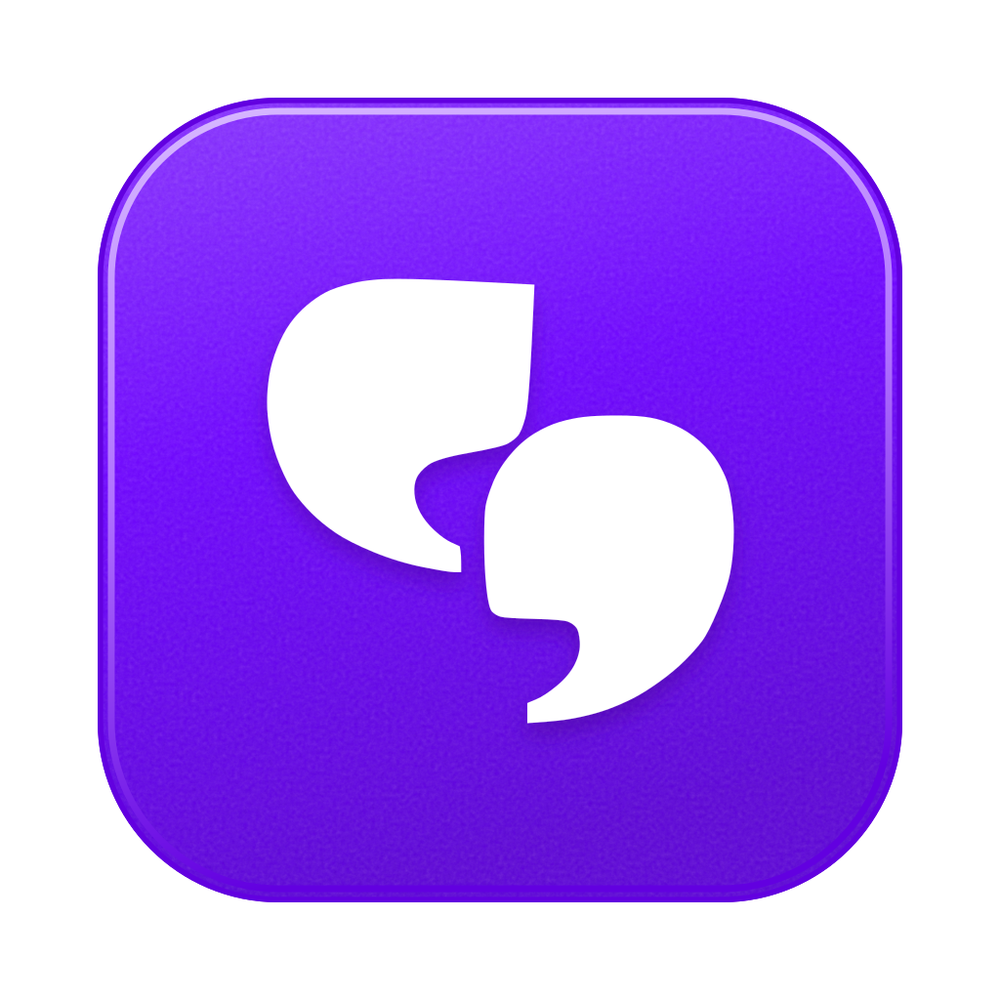
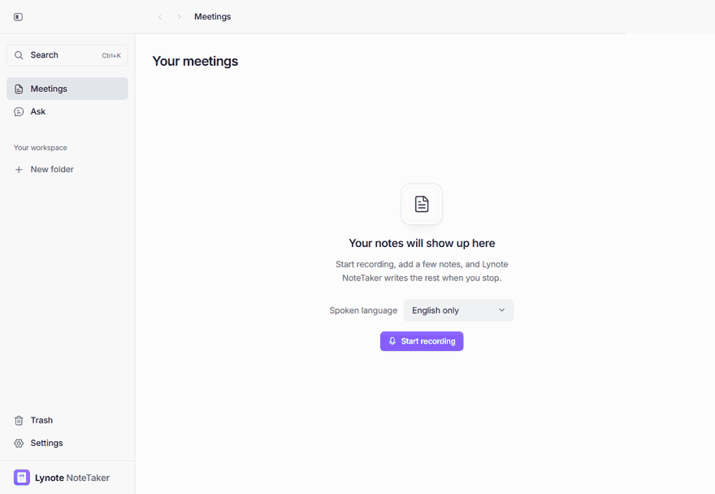
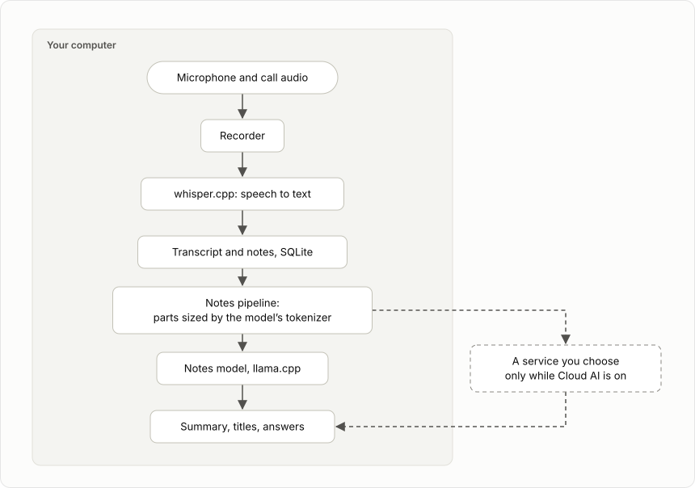
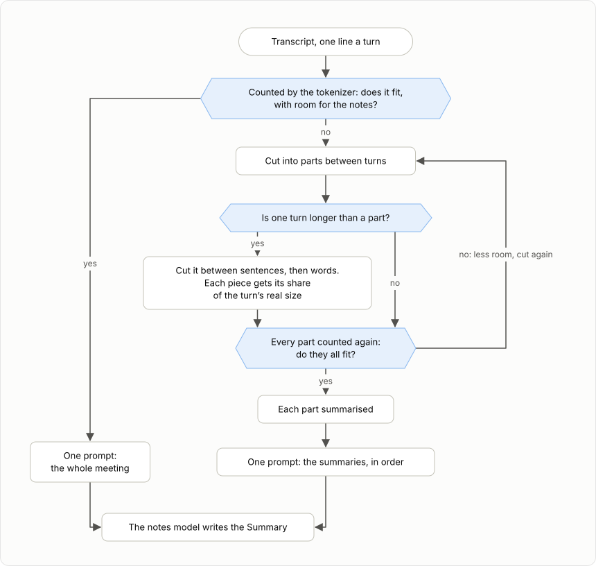
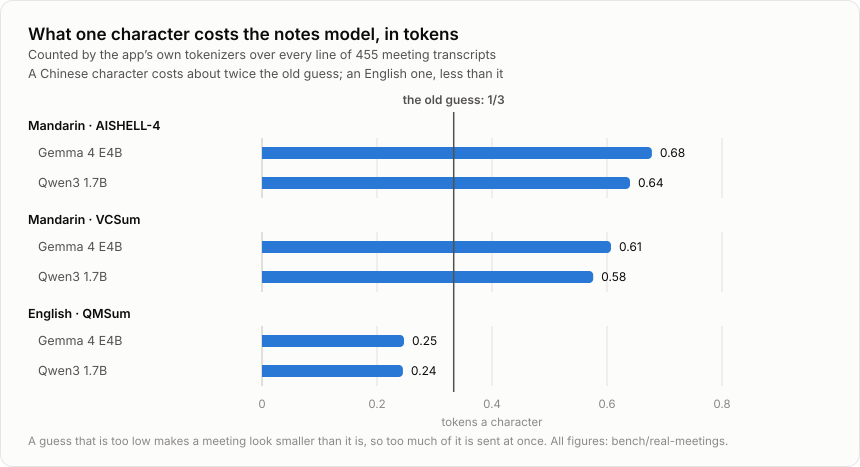
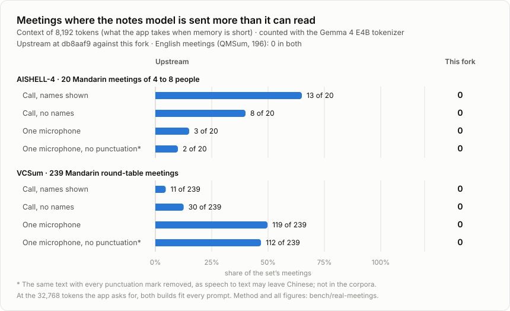
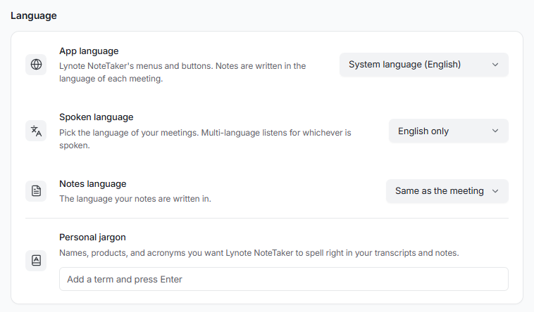
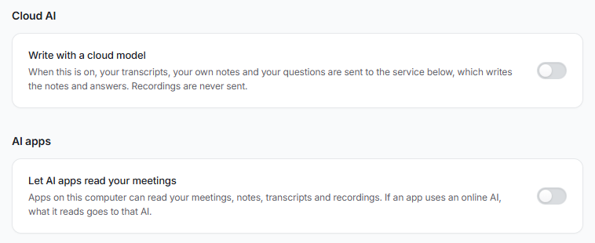

<p align="center">
  
</p>

<h1 align="center">Lynote NoteTaker</h1>

<p align="center">
  AI meeting notes that run on your own computer, and hold up in long meetings in Chinese.<br>
  No bot joins the call. Free and open source.
</p>

<p align="center">
  <a href="LICENSE"></a>
  
</p>

<p align="center">
  <a href="https://github.com/molly554/local-ai-note-taker/releases/latest">Download</a> ·
  <a href="README.zh-CN.md">简体中文</a> ·
  <a href="docs/README.md">Help</a> ·
  <a href="docs/building.md">Build and run locally</a> ·
  <a href="bench/real-meetings/README.md">The measurements</a>
</p>

<p align="center">
  
</p>

<p align="center">
  <sub>The app in demo mode: a stand-in transcript and notes model, so it runs with nothing downloaded. The screens are the real ones.</sub>
</p>

## What it does

Lynote NoteTaker records your microphone and the sound of the call, writes the transcript with whisper.cpp, and writes a Summary with a model running on your computer through llama.cpp. You can ask questions about your meetings, search them, back them up, and let an AI app read them over MCP.

Five things it takes care over:

- **Long meetings in Chinese.** Every part sent to the notes model is sized with the model's own tokenizer, so nothing is cut off without a word, even on a computer short of memory: 0 of 455 test meetings go over.
- **The language of the meeting.** You pick: English, 中文, 日本語, 한국어, Español, Français, Deutsch, Português, Русский or Multi-language. It starts as your computer's language.
- **The language of the notes.** The meeting's, or one you set.
- **A computer too slow for a notes model.** Optional Cloud AI: a service you choose writes the notes. Off by default.
- **Different meetings, different notes.** Templates for a team meeting, a one-on-one, a customer call and an interview; next steps at the top if you want them there; one line of your own instructions. Any Summary can be written again with another template.

## How it works

<p align="center">
  
</p>

| Stage | What runs | Where |
| --- | --- | --- |
| Recording | A small native recorder for the microphone and the call's sound, two tracks | Your computer |
| Speech to text | whisper.cpp, with voice detection, in the language you picked | Your computer |
| Storage | SQLite with full-text search; recordings as files beside it | Your computer |
| Notes | A Gemma, Qwen or gpt-oss model through llama.cpp, the best one your computer can run | Your computer, or the service you chose while Cloud AI is on |
| Questions | The same model, over one meeting or across all of them, naming the meetings it drew on | Same as notes |
| Other apps | A read-only MCP helper, off until you turn it on | Your computer |

### How a long meeting is read

A notes model reads a fixed number of tokens at a time: its context. The app asks for 32,768 and takes as little as 8,192 when memory is short. A meeting that does not fit is read in parts, each part is summarised, and the notes are written from the summaries.

<p align="center">
  
</p>

Three things make it hold:

1. **Count, never guess.** Every line is counted by the tokenizer of the model that is loaded. A guess from the number of characters is right for English and half the real size for Chinese (the first chart below).
2. **A long turn is cut where it can be.** A room on one microphone is one speaker talking for an hour. It is cut between sentences, and a sentence with no punctuation between words. Sentences counted one at a time do not add up to their turn (a tokenizer reads a space at the end of a text differently from one in the middle), so each piece gets its share of the turn's real size.
3. **Every part is counted once more before it is sent.** If one is too big, all are cut again with less room. A prompt that is too big is not an error to the engine: it reads the start and drops the rest, instructions included (the third table below).

## The measurements

455 public meeting transcripts were put through the notes pipeline as it was before these changes and as it is now, with the app's own tokenizers counting what each prompt really costs. The scripts and every result file are in [bench/](bench/real-meetings/README.md).

**1. What a character costs.** The size of a text used to be guessed at a third of a token a character.

<p align="center">
  
</p>

| Meetings | Tokenizer | Tokens a character | The old guess, as a share of the real size |
| --- | --- | --- | --- |
| Mandarin, AISHELL-4 | Gemma 4 E4B | 0.678 | 52% |
| | Qwen3 1.7B | 0.640 | 55% |
| Mandarin, VCSum | Gemma 4 E4B | 0.607 | 56% |
| | Qwen3 1.7B | 0.576 | 59% |
| English, QMSum | Gemma 4 E4B | 0.247 | 137% |
| | Qwen3 1.7B | 0.245 | 139% |

**2. Meetings sent to the model too big to read.** Only when memory is short: at the 32,768 tokens the app asks for, every prompt fits either way.

<p align="center">
  
</p>

Across all 44 combinations of meetings, how they were heard, tokenizer and context, the pipeline now sends no prompt that does not fit, and loses no words.

**3. What a prompt that is too big does.** A real model in the app's own engine (Qwen3 1.7B, context 8,192) was given a transcript with three passwords in it, near the start, the middle and the end, and asked at the end to list them.

| Prompt | Its tokens | Read by the engine | Passwords listed | Error raised |
| --- | --- | --- | --- | --- |
| Fits | 4,486 | 4,494 | 3 of 3 | none |
| Does not fit | 12,934 | 4,846 (37%) | 0 of 3 | none |

The second answer was a summary of a meeting, not a list of passwords: the question at the end never reached the model.

**4. Parts used.** Each part is one more call to the model, so fewer is faster. Meetings on one microphone, context 8,192, Gemma 4 E4B's tokenizer:

| Meetings | Before | Now | Fewest that can hold them |
| --- | --- | --- | --- |
| Mandarin, VCSum (239) | 301, with 119 meetings too big | 348 | 348 |
| English, QMSum (196) | 396 | 280 | 279 |

The first fix guessed a Chinese character at one token and used 536 parts for the Mandarin meetings. Measuring it is what led to counting.

**5. Search in Chinese.** 15 ordinary words were looked up in 259 Mandarin meetings (93,638 lines) through the app's own search: each showed every meeting it should, in 4 to 260 ms. An index to make it faster was built, measured and dropped: [it made common words slower](bench/cjk-search/README.md).

### What is tested

| | How much | When |
| --- | --- | --- |
| Unit tests | over 1,600 | every push, on Windows, Linux and macOS |
| End-to-end tests, the app driven in demo mode | 28 on Windows and Linux, all 340 on macOS | every push |
| Native helpers | built and run on each system | when they change |
| The measurements above | 455 meetings, 44 combinations | by hand; results kept in `bench/` |

## Languages, Cloud AI and templates

The language people speak and the language the notes are written in are two settings. The app itself comes in English and 31 other languages.

<p align="center">
  
</p>

Cloud AI is off until you turn it on. It works with any service that speaks the OpenAI chat format, and the key is encrypted by your system's own key storage.

<p align="center">
  
</p>

A template adds a few lines to what the notes model is asked, for what that kind of meeting needs: who is blocked in a team meeting, what the customer objected to in a call, what the candidate answered in an interview and no verdict on them. What the model may use stays the same: only what was said, or what you typed.

## What leaves your computer

| What | Where it goes | When |
| --- | --- | --- |
| Recordings | Nowhere | Never |
| Transcripts, your notes, Summaries, questions | Nowhere | Unless you turn on one of the next two |
| Transcripts, your notes and your questions | The service you entered in Settings → Cloud AI | Only while Cloud AI is on |
| The meetings an AI app reads over MCP | That app, and its online model if it uses one | Only while Settings → AI apps is on |
| Requests for model files | Hugging Face | During setup, and when a better model for your computer is fetched |
| The check for a new version | This repository's releases on GitHub | While updates are on |

There is no telemetry.

## Install

Every computer needs at least 8 GB of memory. The first run downloads the models.

- **Windows** (10 version 2004 or later, x64) and **Linux** (x64 AppImage, Ubuntu 22.04 or similar): get the installer from [Releases](https://github.com/molly554/local-ai-note-taker/releases/latest). Neither is signed; [Help](docs/README.md#install) says what to click.
- **macOS**: there is no download. It can be [built from source](docs/building.md) on Apple Silicon.

To look around without downloading any model, run it in demo mode. It keeps its own folder, away from your real meetings:

```sh
git clone https://github.com/molly554/local-ai-note-taker.git
cd local-ai-note-taker
pnpm install --frozen-lockfile
pnpm -C app demo
```

<details>
<summary>Licence and credits</summary>

- [MIT](LICENSE). What it is built on: [third-party notices](THIRD_PARTY_NOTICES.md).
- Built on the open-source app Yogurt by Frigade (MIT, version 0.3.6), whose copyright stays in the licence. Not affiliated with or endorsed by Frigade.
- The measurements use [AISHELL-4](https://www.openslr.org/111/) (CC BY-SA 4.0), [VCSum](https://github.com/hahahawu/VCSum) and [QMSum](https://github.com/Yale-LILY/QMSum) (AMI and ICSI, CC BY 4.0). None of their text is in this repository: only the script that fetches them, and counts.

</details>
