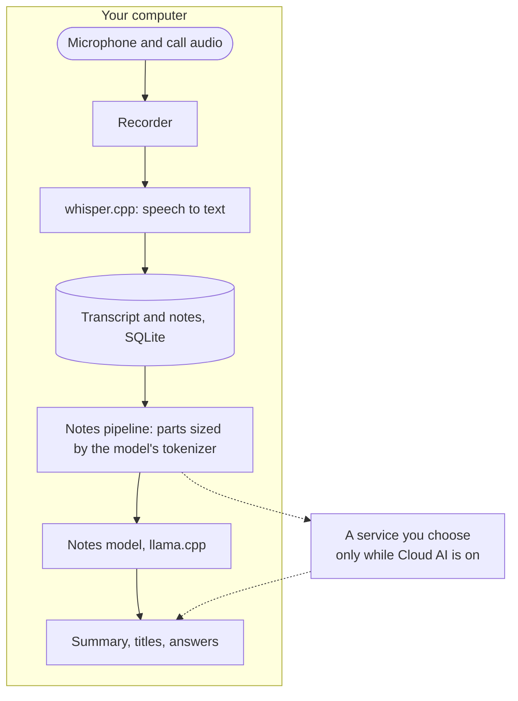

<p align="center">
  
</p>

<h1 align="center">Lynote NoteTaker</h1>

<p align="center">
  AI meeting notes that run on your own computer, and hold up in long meetings in Chinese.<br>
  No bot joins the call. Free and open source.
</p>

<p align="center">
  <a href="LICENSE"></a>
  
  <a href="https://github.com/FrigadeHQ/yogurt"></a>
</p>

<p align="center">
  <a href="https://github.com/molly554/local-ai-note-taker/releases/latest">Download</a> ·
  <a href="README.zh-CN.md">简体中文</a> ·
  <a href="docs/README.md">Help</a> ·
  <a href="docs/building.md">Build and run locally</a> ·
  <a href="bench/real-meetings/README.md">The measurements</a>
</p>

<p align="center">
  
</p>

<p align="center">
  <sub>The app in demo mode: a stand-in transcript and notes model, so it runs with nothing downloaded. The screens are the real ones.</sub>
</p>

## What it is

Lynote NoteTaker is a fork of [Yogurt](https://github.com/FrigadeHQ/yogurt), the local meeting-notes app by Frigade (MIT). It records your microphone and the sound of the call, writes the transcript with whisper.cpp, and writes a Summary with a model running on your computer through llama.cpp. You can ask questions about your meetings, search them, back them up, and let an AI app read them over MCP. All of that is Yogurt's work.

This fork changes four things:

| | Yogurt 0.3.6 | This fork |
| --- | --- | --- |
| **A long meeting in Chinese, on a computer short of memory** | The notes model is sent more than it can read, and the rest is cut off without a word: 119 of 239 test meetings recorded on one microphone | Every part is sized with the model's own tokenizer: 0 of 455 test meetings go over |
| **The language of the meeting** | English, or Multi-language | You pick: English, 中文, 日本語, 한국어, Español, Français, Deutsch, Português, Русский or Multi-language. It starts as your computer's language |
| **The language of the notes** | Always the meeting's | The meeting's, or one you set |
| **A computer too slow for a notes model** | No way round it | Optional Cloud AI: a service you choose writes the notes. Off by default |

## The measurements

The first row is a claim, so it was measured: 455 public meeting transcripts were put through the notes pipeline of both builds, with the app's own tokenizers counting what each prompt really costs.

<p align="center">
  
</p>

- **Chinese is about 0.6 tokens a character.** Upstream guesses a third of a token for any character, so it takes a Chinese meeting for a little over half its real size (52% to 59%).
- **It only shows when memory is short.** At the 32,768 tokens the app asks for, both builds fit every prompt. At the 8,192 it takes when memory is short, upstream goes over in up to 13 of 20 and 119 of 239 Mandarin meetings (Gemma 4 E4B's tokenizer; Qwen3's counts are a little higher). English: 0 of 196 in both.
- **Nothing reports it.** A real model in the app's own engine (Qwen3 1.7B) was given a prompt of 12,934 tokens in a context of 8,192. The engine read 4,846 of them, raised no error, and the answer did not do what the end of the prompt asked.

The same measurements changed the fork twice. Its first fix guessed too high and used 536 parts where 348 would do, each one more call to the model; it now counts with the tokenizer and uses 348. And an index for faster Chinese search was built, measured and dropped: on 200,000 generated lines the existing search took at most 66 ms, and the index made common words slower.

Commands, tables and what the measurements do not show: [bench/real-meetings](bench/real-meetings/README.md) and [bench/cjk-search](bench/cjk-search/README.md).

## Languages and Cloud AI

The language people speak and the language the notes are written in are two settings. The app itself comes in English and 31 other languages.

<p align="center">
  
</p>

Cloud AI is off until you turn it on. It works with any service that speaks the OpenAI chat format, and the key is encrypted by your system's own key storage.

<p align="center">
  
</p>

## How it works



## What leaves your computer

| What | Where it goes | When |
| --- | --- | --- |
| Recordings | Nowhere | Never |
| Transcripts, your notes, Summaries, questions | Nowhere | Unless you turn on one of the next two |
| Transcripts, your notes and your questions | The service you entered in Settings → Cloud AI | Only while Cloud AI is on |
| The meetings an AI app reads over MCP | That app, and its online model if it uses one | Only while Settings → AI apps is on |
| Requests for model files | Hugging Face (on a Mac, also Apple for its optional speech files) | During setup, and when a better model for your computer is fetched |
| The check for a new version | This repository's releases on GitHub | While updates are on |

There is no telemetry.

## Install

Every computer needs at least 8 GB of memory. The first run downloads the models.

- **Windows** (10 version 2004 or later, x64) and **Linux** (x64 AppImage, Ubuntu 22.04 or similar): get the installer from [Releases](https://github.com/molly554/local-ai-note-taker/releases/latest). Neither is signed; [Help](docs/README.md#install) says what to click.
- **macOS** (14.4 or later, Apple Silicon): a release only carries a Mac download when it could be signed and notarized. Otherwise [build it yourself](docs/building.md).

To look around without downloading any model, run it in demo mode (a POSIX shell; Git Bash on Windows). It keeps its own folder, away from your real meetings:

```sh
git clone https://github.com/molly554/local-ai-note-taker.git
cd local-ai-note-taker
pnpm install --frozen-lockfile
pnpm -C app exec electron-vite build
YOGURT_FAKE=1 YOGURT_USER_DATA=/tmp/notetaker-demo pnpm -C app exec electron out/main/index.js
```

## Where it stands

Checked so far: the unit tests, the end-to-end tests that run on Windows (the app in demo mode), and the measurements above.

Not checked yet:

- **A real meeting on an installed copy of this fork.** The changes are in the notes pipeline, the settings and the name; recording and transcription are Yogurt's code, unchanged apart from the name.
- **The Mac and Linux builds by hand.** They are built and tested by the workflows in this repository only.
- **Cloud AI against a real service.** Its tests talk to a stand-in on the same computer.
- **The new texts in 31 languages.** Eleven sentences for the language and Cloud AI settings were translated by a model and have not been read by native speakers.
- **Whether the notes are good.** The measurements count what reaches the model, not what it writes.

On the computer this fork was made on (a 2015 four-core desktop with no usable graphics card), the smallest notes model wrote about 0.3 tokens a second. That is why Cloud AI exists.

## Credits and licence

- A fork of [Yogurt](https://github.com/FrigadeHQ/yogurt) by [Frigade](https://frigade.com), from commit `db8aaf9` (Yogurt 0.3.6). Not affiliated with or endorsed by Frigade. The helper programs and the developer switches keep Yogurt's names (`yogurt-audio`, `YOGURT_FAKE`), so its changes stay easy to bring over.
- [MIT](LICENSE), with Frigade's copyright kept. What it is built on: [third-party notices](THIRD_PARTY_NOTICES.md).
- The measurements use [AISHELL-4](https://www.openslr.org/111/) (CC BY-SA 4.0), [VCSum](https://github.com/hahahawu/VCSum) and [QMSum](https://github.com/Yale-LILY/QMSum) (AMI and ICSI, CC BY 4.0). None of their text is in this repository: only the script that fetches them, and counts.
