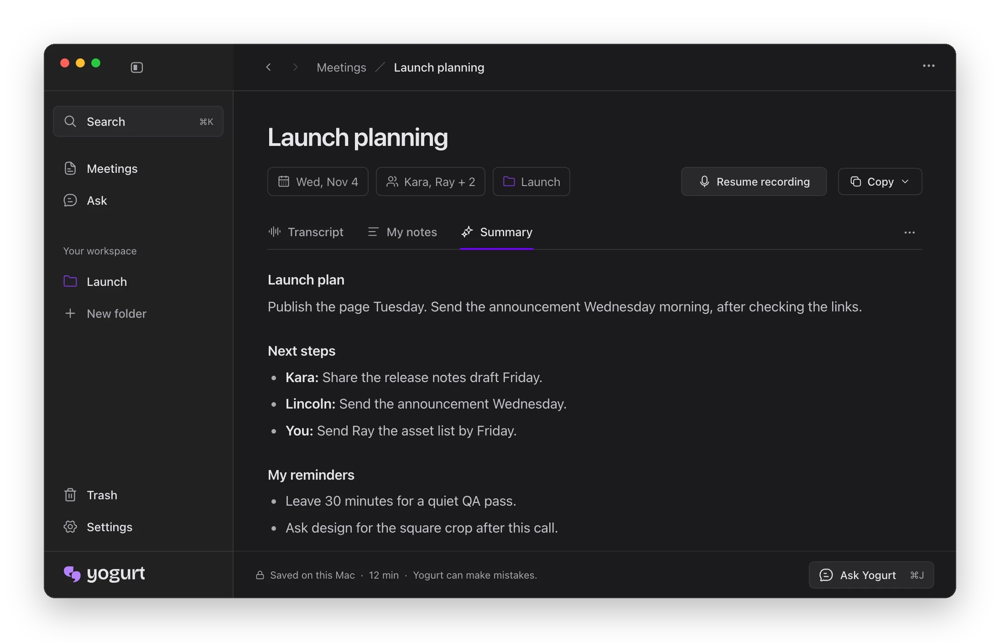

  

  Private AI meeting notes. Free and open source.

  Download for <a href="https://github.com/FrigadeHQ/yogurt/releases/latest/download/Yogurt-mac-arm64.dmg">Mac</a> · <a href="https://github.com/FrigadeHQ/yogurt/releases/latest/download/Yogurt-windows-x64.exe">Windows</a> · <a href="https://github.com/FrigadeHQ/yogurt/releases/latest/download/Yogurt-linux-x86_64.AppImage">Linux</a>

 

  

 

  Yogurt records your calls without adding a bot to the meeting.

  macOS 14.4+ (Apple Silicon) · Windows 10 2004+ (x64) · Ubuntu 22.04+ or similar (x64 AppImage) · 8 GB memory  
  <a href="https://yogurt.so?utm_source=github&utm_medium=readme&utm_campaign=yogurt">yogurt.so</a> · <a href="docs/README.md">Help</a> · <a href="docs/building.md">Build and run locally</a> · <a href="LICENSE">MIT license</a>  
  Made by <a href="https://frigade.com?utm_source=github&utm_medium=readme&utm_campaign=yogurt">Frigade</a>.

