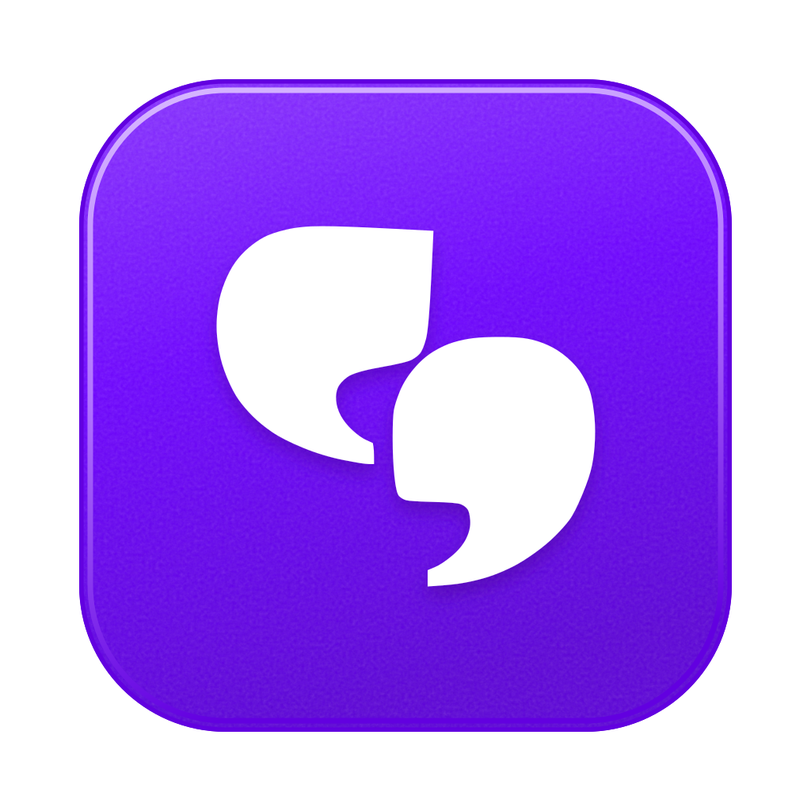
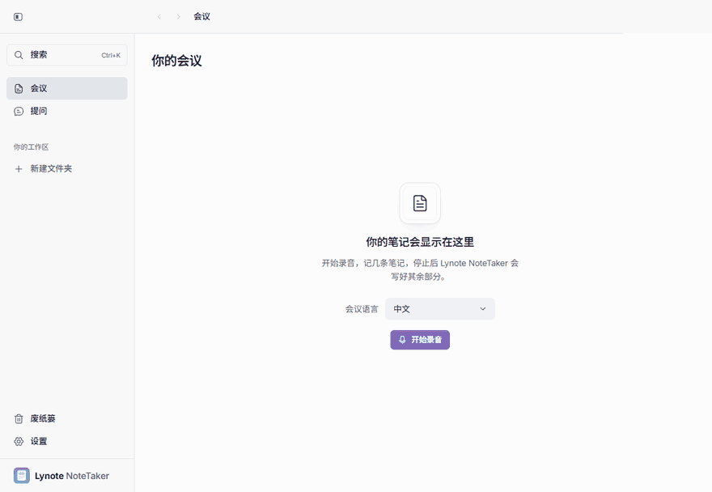
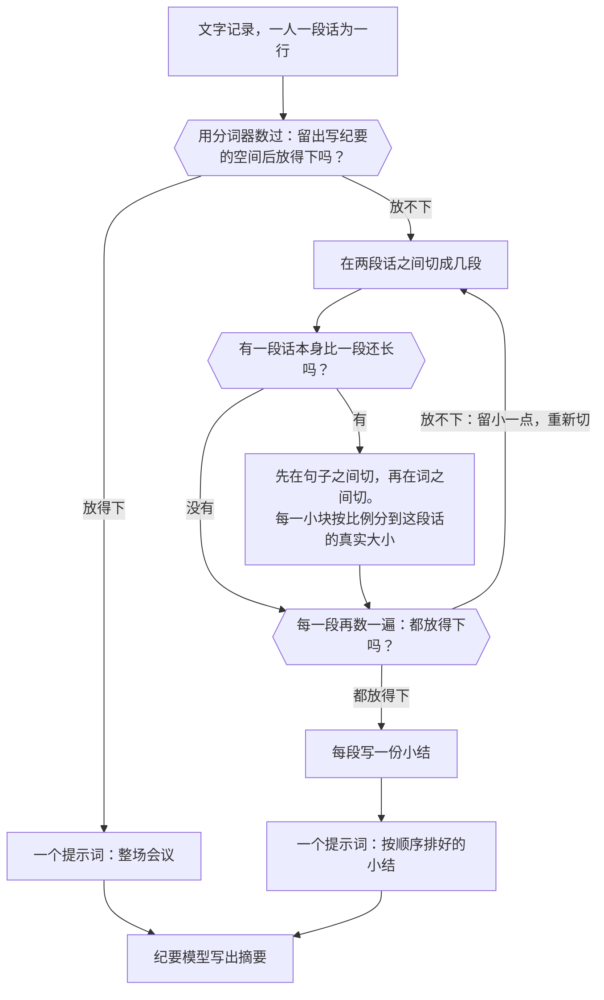
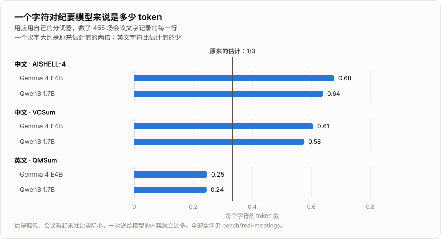
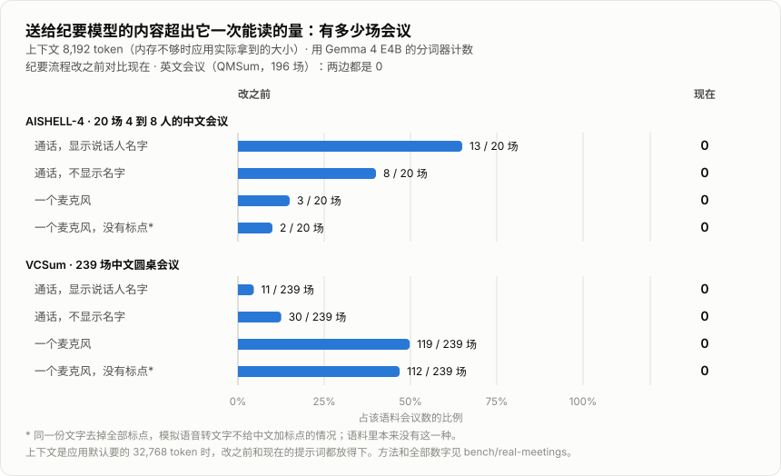
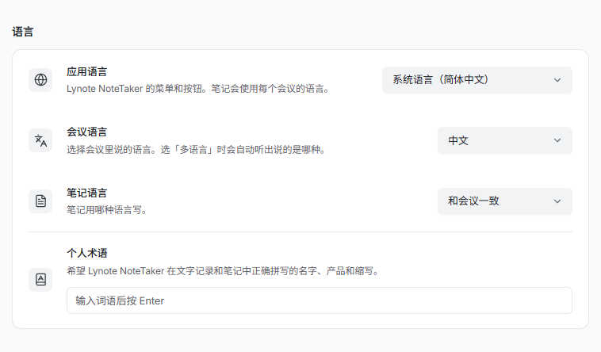

<p align="center">
  
</p>

<h1 align="center">Lynote NoteTaker</h1>

<p align="center">
  在你自己电脑上运行的 AI 会议纪要，长时间的中文会议也能完整读完。<br>
  不往会议里加机器人。免费，开源。
</p>

<p align="center">
  <a href="LICENSE"></a>
  
</p>

<p align="center">
  <a href="https://github.com/molly554/local-ai-note-taker/releases/latest">下载</a> ·
  <a href="README.md">English</a> ·
  <a href="docs/README.md">使用帮助（英文）</a> ·
  <a href="docs/building.md">本地构建和运行（英文）</a> ·
  <a href="bench/real-meetings/README.md">实测数据（英文）</a>
</p>

<p align="center">
  
</p>

<p align="center">
  <sub>这是演示模式：文字记录和纪要模型都是替身，所以不用下载任何模型就能跑，会议内容是内置的英文样例。界面是真实界面。</sub>
</p>

## 它做什么

Lynote NoteTaker 录下你的麦克风和通话里的声音，用 whisper.cpp 转成文字，再用在你电脑上运行的模型（llama.cpp）写出摘要。可以就会议内容提问、搜索、备份，也可以让 AI 应用通过 MCP 读取你的会议。

它在五件事上下了功夫：

- **很长的中文会议。** 送给纪要模型的每一段都用模型自己的分词器量过，内存不够的电脑上也不会有内容被悄悄截掉：455 场测试会议里 0 场超出。
- **会议说的是什么语言。** 自己选：English、中文、日本語、한국어、Español、Français、Deutsch、Português、Русский，或多语言。默认跟随电脑的语言。
- **纪要用什么语言写。** 跟会议一样，或者你指定一种。
- **电脑太慢，跑不动纪要模型。** 可以打开“云端 AI”，让你选的服务来写纪要。默认关闭。
- **不同的会，纪要写法不同。** 有团队会议、一对一、客户通话、面试四种模板；可以让“下一步”排在最前；可以加一句你自己的要求。任何一份摘要都能换个模板重写。

## 工作方式


| 环节 | 用的是什么 | 在哪里运行 |
| --- | --- | --- |
| 录音 | 一个原生的小录音程序，麦克风和通话声音各录一轨 | 你的电脑 |
| 语音转文字 | whisper.cpp，带人声检测，按你选的语言识别 | 你的电脑 |
| 存储 | SQLite，带全文搜索；录音是旁边的文件 | 你的电脑 |
| 纪要 | 通过 llama.cpp 运行 Gemma、Qwen 或 gpt-oss 模型，选你电脑跑得动的最好的那个 | 你的电脑；打开云端 AI 期间是你选的服务 |
| 提问 | 同一个模型，可以问一场会议，也可以跨所有会议问，回答里会标出取自哪几场 | 同纪要 |
| 其他应用 | 只读的 MCP 助手，你打开之前一直是关的 | 你的电脑 |

### 很长的会议是怎么读完的

纪要模型一次只能读固定数量的 token，叫上下文。应用默认要 32,768，内存不够时最少拿 8,192。一场会议放不下，就分段读，每段先写小结，再根据这些小结写纪要。



靠三点保证不出错：

1. **只数，不估。** 每一行都用当前加载的模型自己的分词器来数。按字符数估，英文大致准，中文只有真实大小的一半（见下面第一张图）。
2. **很长的一段话，在能切的地方切。** 会议室里一个麦克风，录下来就是“一个人连续说了一小时”。先在句子之间切；一句话里没有标点，就在词之间切。一句一句分开数再相加，和整段一起数的结果不一样（分词器对结尾的空格和中间的空格读法不同），所以每一小块按比例分到整段的真实大小。
3. **每一段送出去之前再数一遍。** 有一段超了，就留小一点全部重切。超出上下文的提示词对引擎来说不算错误：它读完开头就把后面丢掉，连同写在末尾的要求一起（见下面第三张表）。

## 实测数据

把 455 场公开的会议文字记录分别送进改之前和现在的纪要流程，用应用自己的分词器数出每段提示词实际占多少 token。脚本和每一份结果文件都在 [bench/](bench/real-meetings/README.md) 里。

**1. 一个字符是多少 token。** 原来不管什么字符，都按三分之一个 token 估。

<p align="center">
  
</p>

| 会议 | 分词器 | 每个字符的 token 数 | 原来的估计相当于真实大小的 |
| --- | --- | --- | --- |
| 中文，AISHELL-4 | Gemma 4 E4B | 0.678 | 52% |
| | Qwen3 1.7B | 0.640 | 55% |
| 中文，VCSum | Gemma 4 E4B | 0.607 | 56% |
| | Qwen3 1.7B | 0.576 | 59% |
| 英文，QMSum | Gemma 4 E4B | 0.247 | 137% |
| | Qwen3 1.7B | 0.245 | 139% |

**2. 送给模型的内容超出它一次能读的量：有多少场会议。** 只在内存不够时出现：上下文是默认的 32,768 时，怎么算都放得下。

<p align="center">
  
</p>

会议、听到的方式、分词器、上下文大小一共 44 种组合，现在的流程没有发出过一个放不下的提示词，也没有丢字。

**3. 超出上下文的提示词会发生什么。** 在应用自己的引擎里用真模型（Qwen3 1.7B，上下文 8,192）试：在文字记录的开头、中间、结尾各放一个口令，最后请它把三个口令列出来。

| 提示词 | token 数 | 引擎实际读了 | 列出的口令 | 有没有报错 |
| --- | --- | --- | --- | --- |
| 放得下 | 4,486 | 4,494 | 3 个里的 3 个 | 没有 |
| 放不下 | 12,934 | 4,846（37%） | 3 个里的 0 个 | 没有 |

第二次它回的是一份会议小结，不是口令清单：写在末尾的问题根本没到模型那里。

**4. 切成多少段。** 每多一段就多调一次模型，段数少就快。一个麦克风录的会议，上下文 8,192，用 Gemma 4 E4B 的分词器数：

| 会议 | 改之前 | 现在 | 最少需要 |
| --- | --- | --- | --- |
| 中文，VCSum（239 场） | 301 段，其中 119 场超出 | 348 | 348 |
| 英文，QMSum（196 场） | 396 | 280 | 279 |

第一版修法把一个汉字按 1 个 token 估，中文会议切成了 536 段。正是量出了这个数，才改成用分词器数。

**5. 中文搜索。** 在 259 场中文会议（93,638 行）里用应用自己的搜索查了 15 个常见词：每个词都找全了该出现的会议，用时 4 到 260 毫秒。做过一个让它更快的索引，测完放弃了：[常见词反而变慢](bench/cjk-search/README.md)。

### 测了什么

| | 数量 | 什么时候跑 |
| --- | --- | --- |
| 单元测试 | 1,600 多条 | 每次提交，Windows、Linux、macOS 都跑 |
| 端到端测试（在演示模式下操作应用） | Windows 和 Linux 上 28 条，macOS 上全部 340 条 | 每次提交 |
| 原生辅助程序 | 在每种系统上构建并运行 | 它们有改动时 |
| 上面的实测 | 455 场会议，44 种组合 | 手动跑；结果存在 `bench/` 里 |

## 语言、云端 AI 和模板

「会议语言」和「笔记语言」是两个设置，分开选。应用界面有英语和另外 31 种语言。

<p align="center">
  
</p>

云端 AI 在你打开之前一直是关的。任何兼容 OpenAI 对话格式的服务都能用；密钥由系统自带的密钥存储加密后保存。

<p align="center">
  
</p>

模板是在给纪要模型的要求里加几行，写明这类会议需要什么：团队会议里谁被什么卡住了，客户通话里对方提了哪些异议，面试里候选人怎么回答的、并且不下结论。模型能用的内容不变：只有会上说过的，和你自己写下的。

## 哪些内容会离开你的电脑

| 内容 | 去哪里 | 什么时候 |
| --- | --- | --- |
| 录音 | 不离开 | 任何时候都不 |
| 文字记录、你的笔记、摘要、提问 | 不离开 | 除非你打开下面两项之一 |
| 文字记录、你的笔记、你的提问 | 你在“设置 → 云端 AI”里填的服务 | 只在云端 AI 打开期间 |
| AI 应用通过 MCP 读到的会议 | 那个应用，以及它用的在线模型（如果有） | 只在“设置 → AI 应用”打开期间 |
| 下载模型文件的请求 | Hugging Face | 首次设置时，以及之后下载更适合你电脑的模型时 |
| 检查新版本 | 本仓库在 GitHub 上的发布页 | 自动更新打开期间 |

没有任何使用数据上报。

## 安装

电脑至少要有 8 GB 内存。第一次运行会下载模型。

- **Windows**（10 的 2004 版或更新，x64）和 **Linux**（x64 的 AppImage，Ubuntu 22.04 或相近系统）：到[发布页](https://github.com/molly554/local-ai-note-taker/releases/latest)下载安装包。两个都没有签名，系统拦下时怎么点见[使用帮助](docs/README.md#install)。
- **macOS**：不提供安装包。可以在 Apple Silicon 的 Mac 上[从源码构建](docs/building.md)。

不想下载模型、只想先看看界面，可以用演示模式运行。它用单独的资料夹，不会碰你真实的会议：

```sh
git clone https://github.com/molly554/local-ai-note-taker.git
cd local-ai-note-taker
pnpm install --frozen-lockfile
pnpm -C app demo
```

<details>
<summary>许可和致谢</summary>

- [MIT 许可](LICENSE)。用到的第三方软件见[第三方声明](THIRD_PARTY_NOTICES.md)。
- 基于开源应用 Yogurt（Frigade 出品，MIT 许可，0.3.6 版）开发，许可证里保留了它的版权声明。与 Frigade 没有隶属关系，也没有得到它的背书。
- 实测用到 [AISHELL-4](https://www.openslr.org/111/)（CC BY-SA 4.0）、[VCSum](https://github.com/hahahawu/VCSum) 和 [QMSum](https://github.com/Yale-LILY/QMSum)（AMI 和 ICSI，CC BY 4.0）。仓库里没有这些语料的文字，只有取数脚本和统计数字。

</details>
