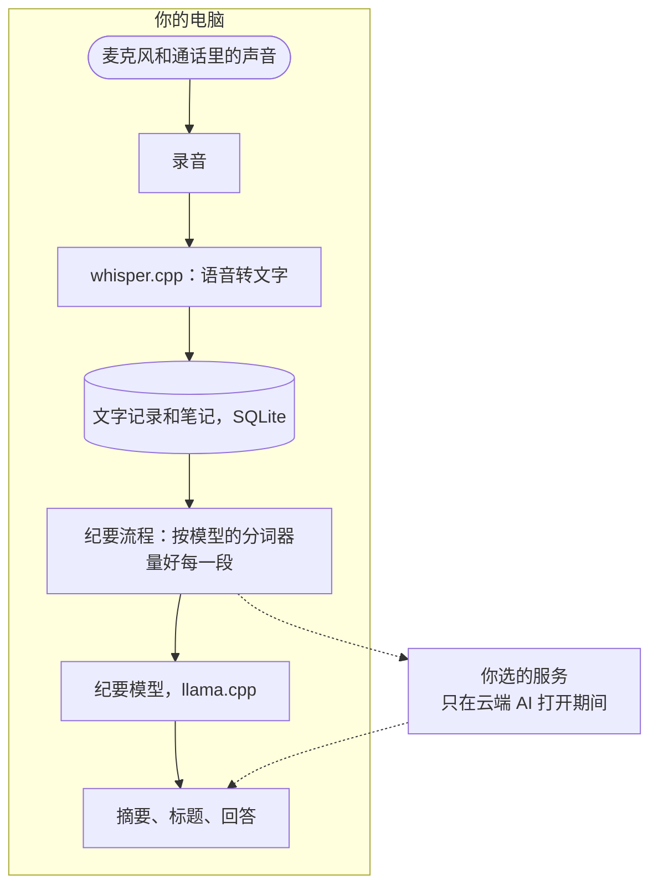

<p align="center">
  
</p>

<h1 align="center">Lynote NoteTaker</h1>

<p align="center">
  在你自己电脑上运行的 AI 会议纪要，长时间的中文会议也能完整读完。<br>
  不往会议里加机器人。免费，开源。
</p>

<p align="center">
  <a href="LICENSE"></a>
  
</p>

<p align="center">
  <a href="https://github.com/molly554/local-ai-note-taker/releases/latest">下载</a> ·
  <a href="README.md">English</a> ·
  <a href="docs/README.md">使用帮助（英文）</a> ·
  <a href="docs/building.md">本地构建和运行（英文）</a> ·
  <a href="bench/real-meetings/README.md">实测数据（英文）</a>
</p>

<p align="center">
  
</p>

<p align="center">
  <sub>这是演示模式：文字记录和纪要模型都是替身，所以不用下载任何模型就能跑，会议内容是内置的英文样例。界面是真实界面。</sub>
</p>

## 它做什么

Lynote NoteTaker 录下你的麦克风和通话里的声音，用 whisper.cpp 转成文字，再用在你电脑上运行的模型（llama.cpp）写出摘要。可以就会议内容提问、搜索、备份，也可以让 AI 应用通过 MCP 读取你的会议。

它在四件事上下了功夫：

- **很长的中文会议。** 送给纪要模型的每一段都用模型自己的分词器量过，内存不够的电脑上也不会有内容被悄悄截掉：455 场测试会议里 0 场超出。
- **会议说的是什么语言。** 自己选：English、中文、日本語、한국어、Español、Français、Deutsch、Português、Русский，或多语言。默认跟随电脑的语言。
- **纪要用什么语言写。** 跟会议一样，或者你指定一种。
- **电脑太慢，跑不动纪要模型。** 可以打开“云端 AI”，让你选的服务来写纪要。默认关闭。

## 实测数据

第一条是一个判断，所以做了实测：把 455 场公开的会议文字记录分别送进改之前和现在的纪要流程，用应用自己的分词器数出每段提示词实际占多少 token。

<p align="center">
  
</p>

- **一个汉字大约 0.6 个 token。** 原来不管什么字符都按三分之一个 token 估，这样估出来的中文会议只有实际大小的一半多一点（52% 到 59%）。
- **只有内存不够时才会出问题。** 上下文是应用默认要的 32,768 token 时，怎么算提示词都放得下。内存不够、只拿到 8,192 时，按估的算，20 场里最多 13 场、239 场里最多 119 场中文会议超出（用 Gemma 4 E4B 的分词器数；用 Qwen3 的数出来略多）。英文会议两种算法都是 196 场里 0 场。
- **超出了也没有任何提示。** 在应用自己的引擎里用真模型（Qwen3 1.7B）试过：上下文 8,192，送进去 12,934 个 token，引擎只读了 4,846 个，没有报错，写出来的内容也没有照提示词末尾的要求做。

这些实测也让做法改了两次。第一版修法估得偏高，348 段就够的内容切成了 536 段，每多一段就多调一次模型；现在改成用分词器数，用的就是 348 段。另外做过一个加快中文搜索的索引，测完放弃了：在 20 万行生成的文字上，原有的搜索最慢 66 毫秒，加了索引后常见词反而变慢。

运行命令、完整表格、这些实测不能说明什么：见 [bench/real-meetings](bench/real-meetings/README.md) 和 [bench/cjk-search](bench/cjk-search/README.md)（英文）。

## 语言和云端 AI

「会议语言」和「笔记语言」是两个设置，分开选。应用界面有英语和另外 31 种语言。

<p align="center">
  
</p>

云端 AI 在你打开之前一直是关的。任何兼容 OpenAI 对话格式的服务都能用；密钥由系统自带的密钥存储加密后保存。

<p align="center">
  
</p>

## 工作方式



## 哪些内容会离开你的电脑

| 内容 | 去哪里 | 什么时候 |
| --- | --- | --- |
| 录音 | 不离开 | 任何时候都不 |
| 文字记录、你的笔记、摘要、提问 | 不离开 | 除非你打开下面两项之一 |
| 文字记录、你的笔记、你的提问 | 你在“设置 → 云端 AI”里填的服务 | 只在云端 AI 打开期间 |
| AI 应用通过 MCP 读到的会议 | 那个应用，以及它用的在线模型（如果有） | 只在“设置 → AI 应用”打开期间 |
| 下载模型文件的请求 | Hugging Face | 首次设置时，以及之后下载更适合你电脑的模型时 |
| 检查新版本 | 本仓库在 GitHub 上的发布页 | 自动更新打开期间 |

没有任何使用数据上报。

## 安装

电脑至少要有 8 GB 内存。第一次运行会下载模型。

- **Windows**（10 的 2004 版或更新，x64）和 **Linux**（x64 的 AppImage，Ubuntu 22.04 或相近系统）：到[发布页](https://github.com/molly554/local-ai-note-taker/releases/latest)下载安装包。两个都没有签名，系统拦下时怎么点见[使用帮助](docs/README.md#install)。
- **macOS**：不提供安装包。可以在 Apple Silicon 的 Mac 上[从源码构建](docs/building.md)。

不想下载模型、只想先看看界面，可以用演示模式运行。它用单独的资料夹，不会碰你真实的会议：

```sh
git clone https://github.com/molly554/local-ai-note-taker.git
cd local-ai-note-taker
pnpm install --frozen-lockfile
pnpm -C app demo
```

## 现在做到哪一步

已经验证过的：单元测试、能在 Windows 上跑的端到端测试（应用处于演示模式）、上面的实测。

还没有验证的：

- **用装好的版本录一场真实的会议。** 目前的工作集中在纪要流程、设置和外观；从安装包录音、转写还没有试过。
- **Linux 版本的人工试用。** 它只由本仓库的自动流程构建和测试。
- **云端 AI 接真实的服务。** 它的测试连的是同一台电脑上的替身服务。
- **31 种语言里的新文案。** 语言设置和云端 AI 设置新增的句子由模型翻译，没有请母语者看过。
- **纪要写得好不好。** 实测数的是送到模型的内容有没有超出，不是模型写出来的质量。

做这个项目用的电脑（2015 年的四核台式机，没有可用的显卡）上，最小的纪要模型每秒大约写 0.3 个 token。这就是加云端 AI 的原因。

<details>
<summary>许可和致谢</summary>

- [MIT 许可](LICENSE)。用到的第三方软件见[第三方声明](THIRD_PARTY_NOTICES.md)。
- 基于开源应用 Yogurt（Frigade 出品，MIT 许可，0.3.6 版）开发，许可证里保留了它的版权声明。与 Frigade 没有隶属关系，也没有得到它的背书。
- 实测用到 [AISHELL-4](https://www.openslr.org/111/)（CC BY-SA 4.0）、[VCSum](https://github.com/hahahawu/VCSum) 和 [QMSum](https://github.com/Yale-LILY/QMSum)（AMI 和 ICSI，CC BY 4.0）。仓库里没有这些语料的文字，只有取数脚本和统计数字。

</details>
